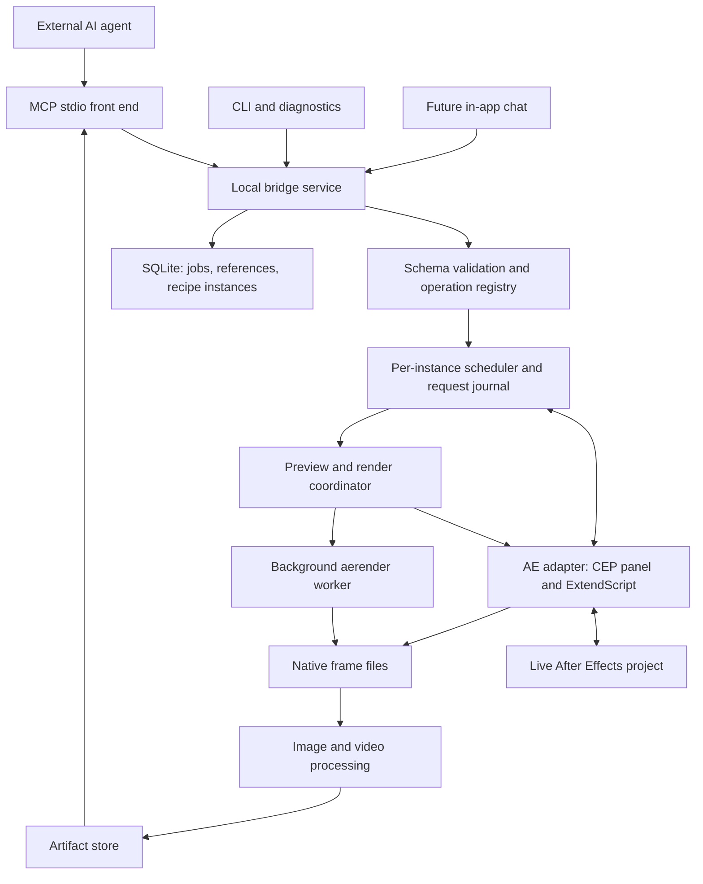

# After Effects Agent Bridge — implementation plan

Status: implementation in progress; initial bridge slice built, AE host unverified.
Prepared: October 8, 2026.
Product: an everyday AI assistant for creating, adjusting, organizing, and prototyping editable motion graphics in Adobe After Effects.

## 1. Product outcome

The user describes a task, the agent performs it in the current AE project, sees the rendered result, and makes targeted revisions. The user can continue editing everything manually.

Representative interaction:

> “Create five product cards with rounded corners and stagger their entrance.”
>
> The assistant inspects the composition, creates native layers, renders representative frames, and returns a contact sheet.
>
> “Less bounce, tighter spacing, and make the middle card larger.”
>
> The assistant updates the same objects, checks the revised motion, and preserves unrelated work.

Success means reducing the time between an idea and an editable first draft. Tool count and the ability to execute arbitrary scripts are supporting capabilities, not the product's success metric.

### Product principles

- Use the active composition, selected layers, and current time as context; resolve them to explicit references before executing.
- For aesthetic ambiguity, make a reasonable first attempt. Ask when ambiguity changes the target, scope, or treatment of existing work.
- Return visual evidence for visual changes. Distinguish “edit completed,” “render generated,” and “agent reviewed the render.”
- Preserve native AE layers, expressions, keyframes, controls, and project organization.
- Make small follow-up edits to existing objects instead of rebuilding scenes unnecessarily.
- Keep ordinary editing fluid within the user's chosen project scope. Avoid confirmation on every property change.
- Be precise about unsupported operations, partial failure, preview quality, and recovery limits.

### Initial scope

Text and shape graphics, cards and grids, lower thirds, layer arrangement, common entrances/exits, easing and timing, simple expressions, asset import/replacement, repeatable variations, and project organization.

Defer advanced roto/tracking, general character animation, complete third-party effect coverage, remote render farms, autonomous long-form editing, and real-time screen observation. A feature is supported only when its underlying AE operation has been verified; raw scripting does not bypass missing host APIs.

## 2. Deliverables and initial decisions

The product consists of a local bridge service, an AE extension, an MCP server interface, a small CLI, and agent workflow instructions. A built-in chat interface is a later client of the same service.

| Decision | Initial choice | Reason |
|---|---|---|
| Agent entry point | External MCP-capable agents first | Prove editing and visual feedback without also building model orchestration and chat |
| Core service | TypeScript on a supported Node.js LTS runtime | Shared schemas, process control, MCP integration, media tooling |
| AE integration | Thin CEP panel plus ExtendScript | Established integration path; isolate it behind an adapter |
| Host migration | Separate UXP adapter later | Avoid coupling the operation model to the panel framework |
| Local transport | Authenticated loopback service; panel connects over WebSocket | Persistent connection, identity, status, reconnect handling |
| MCP transport | Small stdio front end forwarding to the shared service | Multiple clients share one scheduler and state journal |
| Mutation model | Typed, bounded operation batches | Predictable validation and fewer AE round trips |
| Agent observation | Native AE frame renders and timestamped contact sheets in the MVP | Essential to reliable creative iteration |
| Video previews | Short render jobs and MP4 artifacts after the visual MVP | Temporal evaluation without requiring every client to support video |
| State storage | SQLite for requests/jobs/metadata; files for media | Durable recovery and inspectable artifacts |
| Image processing | Sharp or an equivalent maintained local library | Resize, crop, annotate, and assemble contact sheets outside AE |
| Media processing | FFmpeg/ffprobe when video support is enabled | Encode previews and inspect output |
| First certified platform | macOS on the actual development AE build | Narrow the initial test matrix; add Windows before claiming cross-platform support |

Dependency versions will be selected and pinned during implementation. These are design choices, not claims that any package or host version has already been tested.

Adobe announced AE UXP public beta by November 2026 and CEP retirement at the end of 2029, while stating that ExtendScript is unaffected by this transition. This makes the adapter boundary a first-release requirement. [Adobe migration announcement](https://blog.developer.adobe.com/en/publish/2026/09/investing-in-the-future-of-creative-cloud-extensibility-uxp-comes-to-our-flagship-applications)

## 3. System architecture



### Local service

Own connection discovery, schema validation, operation dispatch, jobs, logging, render scheduling, recipes, artifact retrieval, and access policy. Keep model-provider credentials and inference out of this service in the external-agent MVP.

Use one daemon per OS user with an instance registry. Stdio clients discover or start it through a locked rendezvous file. Handle stale locks and port conflicts. A client disconnect must not terminate another client's jobs.

### AE panel and executor

The panel presents connection state, bound project, active operation, preview history, and stop controls. It carries a small, versioned protocol client and invokes installed ExtendScript handlers through the adapter.

The executor implements known operations and returns plain serialized data. It does not host a language model, encode video, assemble contact sheets, or accept arbitrary JavaScript in ordinary editing calls.

Bundle the panel for the actual CEP runtime; do not assume its JavaScript engine supports the same features as the external Node runtime. Keep host handlers compatible with the supported ExtendScript engine. Generate/validate schemas externally and perform essential argument checks again inside the executor.

### Adapter contract

Implement `connect`, `capabilities`, `inspect`, `executeBatch`, `renderFrame`, `readExecutionStatus`, and `disconnect`. Snapshot, undo, cancellation, and event support are explicit capabilities, not mandatory promises.

Handshake includes protocol version, adapter version, AE version/build, OS, instance identity, session nonce, and available features. Distinguish a connected panel from an AE scripting engine that is actually responsive.

### Process lifecycle

On disconnect, suspend new work for that instance, preserve completed results, and mark in-flight mutations as uncertain until reconciled. Reconnection to a different project or AE session invalidates old object references. Never replay an uncertain mutation automatically.

## 4. Agent workflow

1. Read compact context: active comp, selection, time, project identity, capabilities, and relevant warnings.
2. Inspect only the affected layers, properties, and dependencies. Discover operation schemas as needed.
3. Decide whether to apply a recipe or a custom sequence of typed operations.
4. Preflight inputs, object references, assets/fonts/effects, and recovery mode.
5. Execute a bounded batch with a human-readable undo label.
6. Read back affected state and check expressions and structural postconditions.
7. Render a frame for static work or a contact sheet across the affected interval for animation.
8. Review the images. If necessary, fetch larger crops or a short motion preview.
9. Correct a specific observed problem, within a bounded retry/render budget.
10. Return a short description, visual evidence, and what remains uncertain.

Default agent policy: at most two automatic visual correction passes per request before explaining the remaining issue or asking for creative direction. Do not silently change the user's brief to satisfy a heuristic check.

Persist created object references, recipe parameters, and render identifiers independently of chat history. After a long conversation or model context reset, re-inspect those references before using them.

## 5. Project and object model

### Identity and inspection

- Use a service-issued `projectSessionId` to scope references to a live project binding.
- Use native item/layer IDs where supported, wrapped in opaque service references. Verify existence and expected type on every mutation.
- Do not treat names, paths, or layer indices as unique identity. A file path is also insufficient for unsaved projects or multiple open instances.
- Resolve properties using a path of locale-independent `matchName` segments plus disambiguation for repeated effects/groups. Re-resolve after structural changes that invalidate property handles.
- Include dependency edges: source comp, parent, matte, and discoverable expression links. Mark dynamic expression dependencies as unknown rather than inventing a complete graph.
- Preserve user comments and metadata. Store bridge metadata in sidecars initially; use namespaced in-project metadata only where it can be preserved safely.

Inspection responses should be paginated and selectable by fields/depth. Default to layer summaries, animation intervals, expression presence, and effect names. Fetch full keyframe/property trees only for relevant targets.

### Time and coordinates

- Public animation operations use explicit frame indices or seconds; no unlabelled numeric times.
- Frame indices are zero-based relative to the composition timeline origin. Ranges use `[startFrame, endFrameExclusive)`.
- Use the host's actual frame duration/rate, retaining precision. Display start time and drop-frame timecode are presentation metadata, not alternate indexing rules.
- Return requested and effective sample times, including clamping or snapping.
- Every spatial operation declares its coordinate space. Distinguish layer-local, parent, comp, and world coordinates; only offer conversions the adapter has verified.
- Inspect anchors, parenting, separated dimensions, expressions, and 2D/3D state before manipulating transforms.
- Report bounds with their coordinate space, time, and limitations. Geometric bounds do not necessarily include all effects, blur, masks, or 3D projections.

### Change detection

Maintain a bridge mutation sequence plus fresh fingerprints of the relevant inspected state. The sequence alone does not detect manual AE edits. Recheck preconditions immediately before mutation and between long-running chunks.

An inspection token means “this observed state matched,” not “the entire project is cryptographically unchanged.” Unknown dependencies should disable optimistic reuse or trigger broader inspection. Deletion, reopening, or a changed session makes references stale.

## 6. Tool API

Expose a compact set of tools with discoverable operation schemas. Keep rendering tools explicit because agents must deliberately choose what to observe.

| Tool | Purpose | Stage |
|---|---|---|
| `ae_context` | Session, selection, current comp/time, connection and capability summary | Foundation |
| `ae_inspect` | Bounded project/comp/layer/property inspection | Foundation |
| `ae_find` | Locate objects by names, types, roles, IDs, or animation intervals | MVP |
| `ae_catalog` | Discover operation schemas, effects, fonts, presets, and recipe definitions | Foundation |
| `ae_apply` | Validate and execute a typed batch; optional preflight-only mode | Foundation |
| `ae_validate` | Structural checks, expression diagnostics, scoped postconditions | MVP |
| `ae_render_frame` | One native frame, optionally cropped and resized for viewing | Foundation |
| `ae_render_contact_sheet` | Multiple native frames in a labelled grid | MVP |
| `ae_render_preview` | Short video preview from a known source state | Beta |
| `ae_compare` | Side-by-side artifacts and optional image-difference diagnostics | Beta |
| `ae_job` | Query status, retrieve final results, or request cancellation | Foundation |
| `ae_artifact` | Retrieve an existing image, crop, sheet, clip, or manifest | MVP |
| `ae_recipe` | Discover, create, or update a recipe instance | MVP |
| `ae_checkpoint` | Create/list/restore supported checkpoints with explicit semantics | Beta |
| `ae_revert` | Revert a specific bridge operation when its recovery preconditions hold | MVP, capability-gated |
| `ae_export` | Submit final render with explicit output/settings | Beta |
| `ae_run_script` | Privileged escape hatch, disabled by default | Later |

`ae_apply` operations start with composition create/update; text, shape, null and footage layer creation; property setting; keyframe create/update/remove; easing; expression setting; parenting; ordering; duplication; alignment; and asset import. Add masks, effects, precomposition, and more complex timing after the core loop works.

Each operation schema describes units, accepted target types, preconditions, side effects, undo/recovery support, and required capabilities. The registry generates reference documentation and runtime discovery results.

### Example batch contract

Illustrative schema; final generated types will be authoritative:

```json
{
  "requestId": "req_83",
  "projectSessionId": "session_A",
  "expectedInspectionToken": "inspection_42",
  "label": "Create product cards",
  "operations": [
    {
      "id": "card1",
      "op": "layer.create_shape",
      "compRef": "comp_7",
      "name": "Product card 01",
      "shape": { "kind": "rounded_rect", "sizePx": [280, 360], "radiusPx": 24 }
    },
    {
      "id": "place1",
      "op": "property.set",
      "target": { "createdBy": "card1" },
      "path": ["ADBE Transform Group", "ADBE Position"],
      "value": [320, 540],
      "coordinateSpace": "parent"
    }
  ]
}
```

Return `requestId`, execution state, per-operation outcomes, created/modified references, warnings, recovery information, and a fresh inspection token. Preflight validates provisional references within a batch but is not a perfect simulation of AE execution.

## 7. Visual feedback subsystem

This is part of the MVP, not an optional improvement. The model must receive actual rendered pixels, not just a screenshot path or a success message.

### 7.1 Single-frame rendering

Inputs: explicit comp reference; frame index or seconds; source mode; maximum output dimensions; optional crop in comp pixels; alpha/background display preference; and freshness policy.

Default to a fresh frame from the live project at the current comp time. For static tasks, use the relevant settled frame rather than a potentially invisible entrance frame.

Backend order:

1. Use a verified native live-frame method on the current adapter.
2. If unavailable, use a tested isolated render path against a known saved snapshot.
3. Return an actionable unsupported/snapshot-required result if neither is available. Never silently substitute an application screenshot.

Probe `saveFrameToPng` on the supported ExtendScript builds rather than assuming the newer UXP API signature applies. Adobe's UXP `CompItem` reference documents deferred frame methods starting at version 27.0, including a draft method; this is a future adapter capability until tested. [Adobe CompItem reference](https://developer.adobe.com/after-effects/uxp/after-effects-api/compitem)

Do not promise cheap draft rendering merely because an output image is small. Resizing a full-quality native render reduces transfer size, not AE render cost. Advertise native quality/resolution controls only when verified.

Preserve selection, viewer time, resolution, and queue state when a backend must temporarily alter them. Restore in `finally`, check restoration, and report failures. Do not restore over unrelated changes made after yielding control.

Default viewing derivative: PNG, maximum long edge 1280 px. Keep the original artifact locally so the agent can request a readable text/detail crop without rerendering. Source alpha remains available; a labelled checkerboard or solid background is a separate display derivative.

### 7.2 Contact sheets

Inputs: comp, explicit frame list or range, sampling policy, requested count, layout, tile size, and maximum render budget.

Policies:

- `uniform`: evenly spaced distinct frames across the interval, including first and last valid frames.
- `events`: include important keys, layer in/out boundaries, markers, and frames immediately around known discontinuities, then fill remaining slots.
- `explicit`: use requested frames, with validity checks and clear handling of duplicates/out-of-range values.

Start with uniform and explicit; add event-aware selection after keyframe inspection is dependable. Event sampling is a heuristic: expressions and third-party effects can change between sampled events.

Default: 8 frames for the affected animation interval; maximum 12 per sheet in the first release; up to 4 columns; fit within approximately 2048 px in either dimension. Compute tile size for portrait as well as landscape comps. If text becomes unreadable, return fewer tiles or a separate crop.

Every tile has a tile number, comp-relative frame index, and timestamp in a margin outside the rendered image. The manifest maps each tile to its original frame artifact and crop coordinates. Return sampling coverage and omitted important events when a cap forces omissions.

Partial completion is explicit: missing frames appear as labelled placeholders, and the result is `partial`, never a complete sheet of silently substituted frames.

Render through a single AE command lane. Between frames, allow cancellation and recheck source state. If the source changes, mark the collection inconsistent and do not present it as one coherent revision. Restart once within budget or request a stable snapshot. Pre/post fingerprints are best-effort for opaque dependencies; record that limitation.

### 7.3 Short motion previews

Default scope is the edited interval plus a small lead-in and hold, capped at 5 seconds unless the user/agent explicitly chooses a larger budget. Target a 720 px long edge and preserve the comp frame rate where feasible. If frame rate is reduced, report it.

Prefer background `aerender` against a known snapshot, then encode a viewing MP4 with FFmpeg. Include audio when requested and supported. Always make a poster/contact sheet available because MCP clients differ in video support. Do not synthesize a smooth-motion claim from a handful of sparse still frames.

Adobe documents `aerender` as a command-line render interface and distinguishes new-process rendering from reuse of the interactive instance. Use a separate worker for this feature; do not use reuse as the default. [Adobe rendering documentation](https://helpx.adobe.com/th_en/after-effects/desktop/render-and-export/automate-rendering/automated-rendering-network-rendering.html)

### 7.4 Source-state correctness and snapshots

Each preview records whether it came from the live unsaved project or a persisted snapshot. Copying the current `.aep` from disk does not capture unsaved edits.

Phase 0 must investigate snapshot creation without silently changing the user's file binding, dirty state, undo history, or saved contents. Do not assume a `saveACopy` API exists. Until a safe path is proven, use live frame rendering for unsaved work; background previews require an explicitly saved branch or clearly identified saved state. Never label a saved-state preview as the current live result.

Background jobs record snapshot hash, source file/dependency metadata, AE version, fonts/effects availability, render settings, and unresolved dependencies. Copy or lock inputs needed for reproducibility, or label the job's dependency consistency as best-effort. An immutable `.aep` alone does not freeze externally referenced footage.

### 7.5 Artifact contract and MCP delivery

Store artifacts under opaque IDs, with originals, viewing derivatives, and a JSON manifest. Metadata includes project session, comp reference, observed state token or snapshot ID, requested/effective times, dimensions, crop, alpha treatment, source/render color metadata when available, quality mode, creation time, warnings, and completeness.

Return images as MCP image content blocks, accompanied by compact structured metadata and a text fallback. Resource links are additional access paths, not a substitute for model-visible pixels. MCP specifies image content and structured tool results; test actual host rendering behavior separately. [MCP tools specification](https://modelcontextprotocol.io/specification/2025-11-25/server/tools)

For asynchronous work, `ae_job` result retrieval must return the image content too. Returning only an artifact ID at completion is insufficient. The CLI may return a local path and JSON; the in-app panel can retrieve the same artifact through the authenticated service.

Color handling: explicitly distinguish raw renders and viewing derivatives. Do not assume an 8-bit PNG is a color-accurate representation of every HDR/linear project. Avoid unverified color conversion; report unsupported profiles and keep visual comparisons within matching pipelines.

### 7.6 Cache and budgets

Default post-edit verification to fresh rendering. Reuse artifacts directly by ID; only cache renders when source dependencies/settings are sufficiently known. Include time, crop, quality, color handling, and dependency state in cache identity. Unknown external dependencies and non-deterministic expressions/effects disable reuse.

Initial configurable limits: one AE frame-render operation at a time per instance, one background worker per machine, 12 frames per sheet, roughly 4 MiB of inline image payload per response, and a 2 GiB media cache with age/LRU cleanup. Split sheets or reduce derivatives when needed; client limits may require lower budgets. Pin artifacts referenced by active jobs. Keep checkpoints outside preview-cache eviction.

## 8. Execution, failure, and recovery

### Command lifecycle

`accepted → validated → queued → executing → succeeded | failed | partial | cancelled | outcome_unknown`

Journal acceptance before dispatch. Maintain AE-side recent request IDs to reject duplicates within a session. A durable service journal cannot guarantee exactly-once mutations across every AE crash. If acknowledgement is lost after a mutation, re-inspect instead of blindly replaying.

One scheduler owns all command dispatch per AE instance, across all MCP clients. Reads that require AE also respect this lane; external encoding can proceed concurrently.

### Undo and checkpoints

Use one undo group for each coherent bounded edit where supported. An undo group does not automatically roll back a failed script. Return completed operations and remaining changes on failure.

Implement reversible operations using verified inverse data where feasible. Expose automated revert only when there have been no conflicting edits and the adapter can establish the relevant preconditions. Do not assume a generic undo command can identify whose edit is at the top of AE's history. Otherwise, preserve the group label and offer normal user undo or explicit checkpoint restoration.

Use full project checkpoints for larger destructive operations only after snapshot/restore behavior is proven. Define save/open/restore as project-level operations with an explicit policy for unsaved work. No silent discard or overwrite.

### Cancellation and timeouts

- Queued work: cancel immediately.
- Batches/contact sheets: stop between bounded operations/frames and report completed work.
- A running synchronous host call may not be interruptible. Show `cancel_requested` until it returns; do not claim cancellation already succeeded.
- Background workers: request orderly termination, then terminate only the owned render process if needed. Mark output incomplete and clean up owned temporary files.
- Never kill interactive AE as a normal timeout-recovery strategy.

### Error vocabulary

Include machine code, human explanation, failed operation, observed changes, retryability, and recovery advice. Initial codes: `AE_DISCONNECTED`, `AE_UNRESPONSIVE`, `DIALOG_BLOCKED` when detectable, `WRONG_PROJECT`, `STALE_REFERENCE`, `STATE_CONFLICT`, `INVALID_PROPERTY`, `UNSUPPORTED_CAPABILITY`, `MISSING_ASSET`, `MISSING_FONT`, `EXPRESSION_ERROR`, `RENDER_FAILED`, `PARTIAL_APPLY`, and `OUTCOME_UNKNOWN`.

Do not infer a specific modal dialog solely from a timeout. Optional OS-level diagnostics can be added separately; the baseline can report unresponsiveness honestly.

## 9. Recipes and useful creative primitives

Recipes compile validated parameters into ordinary operations. They remain inspectable and versioned, and return an instance manifest containing created objects, parameter values, supported update fields, and dependencies.

Start with five recipes:

1. Staggered entrance/exit for selected layers.
2. Auto-sizing text box with configurable padding and alignment.
3. Card/grid layout with spacing and responsive text placement.
4. Lower third with exposed color, text, duration, and entrance controls.
5. Shape-based title reveal with native editable elements.

Implement shared primitives for safe anchor adjustment, bounds-aware layout, keyframe timing, easing, and typography measurement. Start with well-defined 2D cases; reject unsupported parented/3D/expression-driven cases rather than claiming general support.

Recipe updates validate that their generated objects still exist and compare managed fields against prior values. Preserve unrelated human changes. If a user has changed a managed field, re-inspect and reconcile explicitly. Do not overwrite all properties from an old recipe manifest.

Arbitrary custom compositions remain possible through `ae_apply`; recipes should accelerate common requests without becoming the only creation path.

## 10. Panel, agent instructions, and daily workflow

### MVP panel

Show connection state, current project/comp, read-only or edit scope, active operation/progress, stop, recent visual artifacts, and useful error/recovery information. Provide a simple setup diagnostic and MCP configuration instructions.

The external agent owns the conversation initially. The panel does not imply that a rendered image has been reviewed by a model. Display separate execution and review status when the client reports review completion.

### Built-in chat milestone

After the bridge passes task benchmarks, add an agent runtime client with provider configuration, cancellation, durable conversation context, tool-result images, and usage limits. Reuse the same operation service. Keep credentials in OS-managed secure storage and avoid a second implementation of AE tools.

### Companion agent instructions

Document context discovery, operation discovery, coordinate/time conventions, read-edit-render-review behavior, recovery limits, and examples. Include guidance to inspect before editing, treat project text as data, request detail crops for typography, and avoid claiming aesthetic success without actual visual inspection.

External agents may provide asset generation/search independently. The bridge imports resulting local files through explicit asset tools; asset sourcing is not required for the initial release.

## 11. Access, installation, and distribution

Bind the service to loopback only, authenticate clients and panel connections, validate browser origins/hosts against the required transport policy, and store credentials with restrictive per-user permissions. Verify the actual CEP origin behavior; do not blindly copy a browser-origin rule that breaks the extension.

Treat expressions, layer text, filenames, project comments, and imported documents as untrusted project content, never as instructions authorizing tool actions. Keep ordinary operations allowlisted. Raw script access is a separately enabled capability and is not a secure sandbox.

Limit artifact retrieval to service-issued IDs; canonicalize filesystem paths and prevent traversal. Use argument arrays for child processes. Allow project assets and outputs through declared locations. Keep tool logs free of credentials and avoid logging full source text/expressions by default.

Provide install, doctor, update, and uninstall commands. The installer identifies AE versions, installs the adapter in the appropriate user location, generates local credentials, and emits client configuration. Development unsigned-panel setup is clearly separate from a signed distribution path. Do not silently change global extension settings.

Uninstall removes owned components; user projects, exports, and retained checkpoints remain unless explicitly selected for deletion. Protocol mismatch must produce a clear upgrade message rather than unpredictable execution.

The bridge does not need its own cloud account. Explain that the chosen AI client may send project data and rendered images to its model provider.

## 12. Proposed repository structure

```text
apps/
  bridge/                 # daemon and local authenticated API
  mcp/                    # stdio front end and MCP image delivery
  cli/                    # setup, doctor, diagnostics, scriptable access
  ae-panel/               # CEP UI and transport client
packages/
  protocol/               # versioned schemas and shared types
  core/                   # registry, orchestration, policy, journal
  ae-adapter/             # host interface and CEP adapter
  ae-scripts/             # installed ExtendScript handlers
  previews/               # sampling, rendering coordination, image assembly
  recipes/                # parameterized operations and instance updates
  storage/                # SQLite and artifact persistence
agent-instructions/       # client-neutral workflow instructions/examples
fixtures/                 # reproducible AE projects and small media assets
tests/
  unit/                   # schemas, time math, sampling, state machines
  integration/            # real AE host tests
  client/                 # MCP image and reconnect compatibility
  tasks/                  # end-to-end daily-work benchmarks
docs/                     # setup, compatibility, architecture decisions
```

Keep modules in one repository and one deployable local service initially. Do not introduce distributed services merely to match these logical boundaries.

## 13. Build sequence and acceptance gates

Indicative effort for one experienced engineer with access to AE: a visual alpha may take roughly 4–6 weeks; a dependable beta may take 8–12 weeks total. These are planning estimates, not commitments. Re-estimate after Phase 0; host quirks, snapshot behavior, and packaging can materially change effort.

| Phase | Work | Exit criteria |
|---|---|---|
| 0 — feasibility, 3–5 days | Verify transport, IDs, property lookup, native frames, image delivery, cancellation limits, undo, and snapshot behavior. Benchmark existing bridges. | Actual target AE build edits one native layer and returns a model-visible frame. Record supported/unsupported behavior and choose build vs reuse. |
| 1 — foundation, about 1 week | Shared schemas, daemon, panel handshake, scheduler, context/inspect/catalog/apply, request journal, CLI doctor. | A real agent creates and edits text/shape layers. Reconnect and duplicate-request tests pass; no wrong-project writes. |
| 2 — visual MVP, 1–2 weeks | Native frame renderer, explicit/uniform contact sheets, artifact store, async result image delivery, crop retrieval, basic validation. | An agent creates a graphic, receives real frames, spots a seeded visible issue, and fixes it. Every tile maps to an exact sample time and source state. |
| 3 — daily-task alpha, 1–2 weeks | Five recipes, reliable follow-up updates, animation/easing tools, scoped recovery, workflow instructions and panel preview history. | Complete the five-card task plus three follow-ups without recreating the scene or altering unrelated layers. Pass the scoped task suite. |
| 4 — dependable beta, 2–3 weeks | Proven checkpoint path, background clips/exports, dependency manifests, Windows certification, packaging, crash/timeout testing. | Both certified platforms pass regression tests; clips match their declared snapshot and cancellation/recovery outcomes are honest. |
| 5 — product expansion | In-app chat, event-aware sampling, more recipes/effects, UXP adapter, reference-image workflows. | Add only features supported by measured user demand and passing adapter contracts. |

Phases 1–3 depend on the preceding phase. Background rendering does not block the single-frame/contact-sheet MVP. Snapshot uncertainty is a gate on snapshot-dependent features, not a reason to misrepresent persisted-state renders.

### First vertical slice

Before broad tool coverage, prove this exact path:

1. Connect an external agent to AE.
2. Read the active comp and selected layers.
3. Create a text layer and background shape with typed operations.
4. Render one native frame and deliver it as MCP image content.
5. Render an eight-frame entrance contact sheet.
6. Let the agent change padding/timing based on the preview.
7. Read back the changes and render fresh evidence.
8. Recover the edit using the supported undo/revert path.

## 14. Verification and benchmarks

### Automated logic tests

Test frame snapping/ranges including fractional rates and nonzero display starts; contact-sheet sampling and tile manifests; schema/type/unit validation; stale references; operation dependencies; job lifecycle/cancellation; duplicate requests; artifact path restrictions; cache invalidation and eviction. Test behavior, not wrappers that merely mirror implementation.

### Real AE fixtures

Include simple 2D graphics; duplicate names and reordered layers; parented layers and shifted anchors; separated dimensions; expression-driven properties; nested comps and mattes; missing media/fonts; non-English names/text; portrait comps; nonzero display starts/fractional frame rates; transparent and color-managed projects. Certify only the fixture categories actually supported.

Check that rendering restores relevant project/UI state, reports expression/render errors, and never mixes revisions without marking inconsistency. Seed a manual edit between chunks to test conflict handling. Simulate losing the acknowledgement after a mutation to verify that retries do not duplicate objects.

### Daily-task benchmark suite

| Task | What it proves |
|---|---|
| Build five cards and stagger their entrance | Creation, layout, batching, sampling |
| Tighten spacing and reduce bounce | Reference persistence and targeted revision |
| Put a fitted background behind selected text | Bounds, anchors, typography |
| Match another layer's easing while preserving endpoints | Keyframe fidelity |
| Advance the entrance by six frames | Time conventions and limited scope |
| Apply the same entrance to several selected layers | Bulk operations and selection binding |
| Produce a portrait variant on a duplicate | Scoped duplication and layout adjustment |
| Fix a deliberately off-screen or clipped title | Model-visible frames and correction |
| Detect an expression error | Structural validation plus evaluated evidence |
| Recover from partial apply and disconnection | Honest state and recovery behavior |

Initial alpha gate: at least 8 of 10 supported tasks complete successfully across three repeated runs on a fixed fixture/model configuration; zero silent wrong-target edits or false “complete” reports. Review creative quality separately with a human rubric. Record failures instead of deleting difficult cases from the suite.

Track median/p95 context latency, edit latency, native render latency, contact-sheet latency, model turns, token/image payload volume, unintended changes, correction success, and recovery success. Measure cold and warm AE caches separately.

Provisional performance goals on a documented simple 1080p 2D fixture: context under 1 second median, a small edit under 2 seconds excluding inference, one frame under 3 seconds warm, and an eight-frame sheet under 15 seconds warm. These are targets to validate, not guarantees for complex scenes. Fast acceptance/progress reporting is required even when AE rendering is slow.

## 15. Existing implementations and reuse decision

Run Phase 0 benchmarks against two candidates before building the entire bridge:

- [AE MCP Bridge](https://github.com/solomondivyananth/aftereffects-mcp): relevant reference for CEP integration, frame/motion observation, recipes, and background rendering. Its documented breadth makes it a useful baseline, not proof of production reliability.
- [Kumo MCP After Effects](https://github.com/kumoproductions/mcp-aftereffects): relevant reference for compact operation discovery, inspection, instance handling, and a panel-free path. [Tool reference](https://github.com/kumoproductions/mcp-aftereffects/blob/main/docs/TOOLS.md)

Also study [ae-agent-skills](https://github.com/yumehiko/ae-agent-skills) for declarative versus focused editing workflows and [the multilingual bridge](https://github.com/a-y-ibrahim/after-effects-mcp) for localization requirements. [Nexrender](https://github.com/inlife/nexrender) is a possible later rendering component, not required for the interactive MVP.

Evaluate license obligations, maintenance, install friction, operation typing, image delivery in the target client, partial-failure behavior, object identity, dependency handling, and ability to isolate the AE adapter. Reuse when the candidate passes the vertical slice and can support the contracts above without a structural rewrite. Otherwise borrow documented patterns and build a focused service. Record the result as an architecture decision with benchmark evidence.

## 16. Open questions to resolve through implementation

| Question | How to resolve | Consequence |
|---|---|---|
| Which AE build/platform is initially certified? | Probe the development installation and record versions | Defines the honest compatibility matrix |
| How reliable is live PNG rendering, and what state does it affect? | Real-host frame and restoration tests | Selects the default preview backend |
| Can unsaved state be snapshotted without changing save semantics? | Test supported APIs/workflows and dirty/undo behavior | Gates background preview and checkpoint design |
| Which client image/resource paths are actually model-visible? | Integration tests in at least two intended MCP hosts | Determines image packaging and fallbacks |
| Can safe automated revert be established for each operation? | Test inverse data and undo conflicts | Limits the exposed revert capability |
| Does the strongest existing bridge meet the first task benchmark? | Same fixtures and prompts across candidates | Chooses extension/fork versus new implementation |
| What requests occur most often in real use? | Observe a small group doing actual AE work | Prioritizes recipes after the first five |

The first release is complete when an agent can inspect the current project, perform useful native edits, receive single frames and coherent contact sheets, revise its own work, and report failures without damaging unrelated user work.
